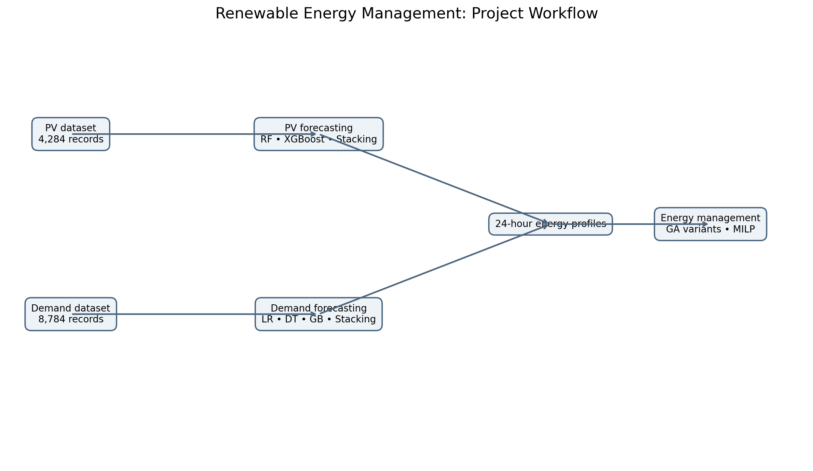
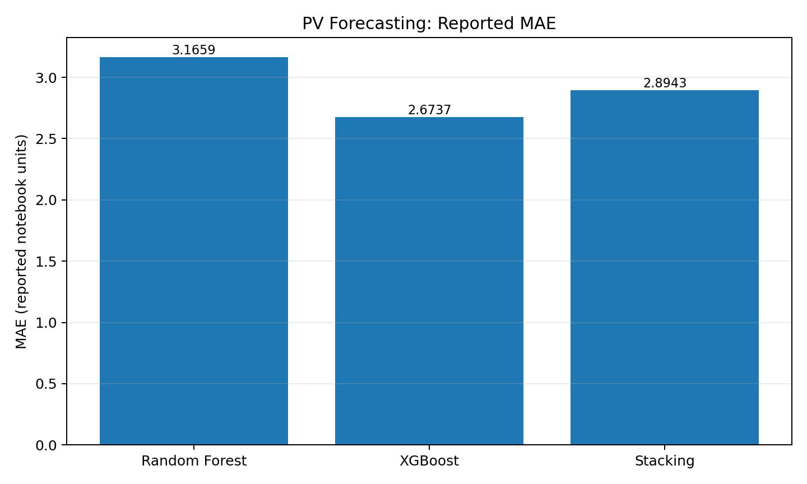
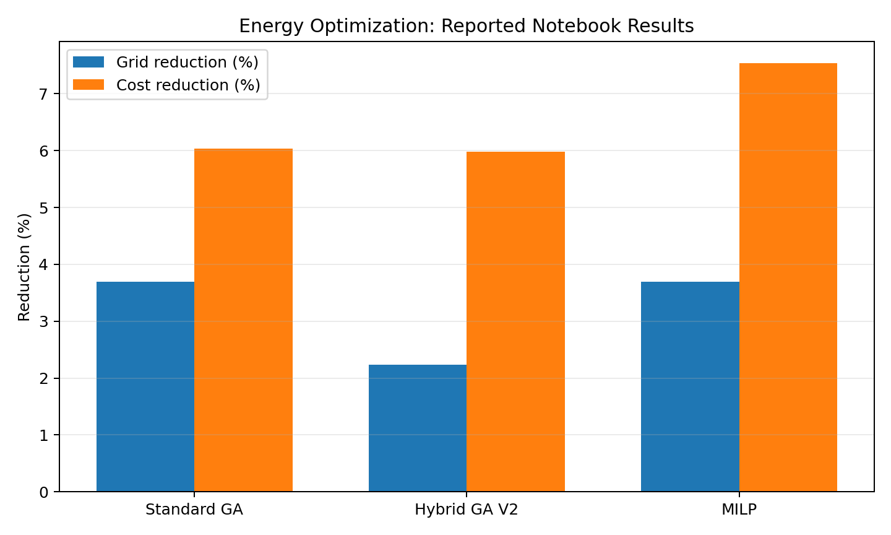

# Renewable Energy Management Using Machine Learning and Genetic Algorithms

An academic implementation of a forecasting-informed Energy Management System (EMS), combining solar photovoltaic (PV) generation forecasting, electricity-demand modelling, Genetic Algorithm (GA) scheduling experiments, and Mixed Integer Linear Programming (MILP).


## Project at a glance

- PV forecasting dataset: **4,284 rows × 8 columns**
- Demand dataset: **8,784 rows × 10 columns**
- PV models: Random Forest, XGBoost, and a stacking ensemble
- Demand models: Linear Regression, Decision Tree, Gradient Boosting, and a stacking ensemble
- EMS optimization experiments: standard GA, hybrid GA variants, and MILP

## Workflow



1. Load and prepare PV and demand datasets.
2. Train regression models for PV power and electricity demand.
3. Generate hourly energy profiles used by the EMS simulation.
4. Evaluate GA-based scheduling strategies and a MILP alternative.
5. Compare the notebook's reported grid-energy and cost-reduction results.

## Dataset overview

### PV dataset

The supplied PV CSV contains 4,284 records and these columns:

`PV power`, `Direct-in-plane`, `Sun Height`, `Air Temperature`, `Wind speed`, `month`, `day`, `hour_minute`.

### Demand dataset

The supplied demand CSV contains 8,784 records and these columns:

`Discharge(Wh)`, `Charge(Wh)`, `Production(Wh)`, `Consumption(Wh)`, `Feed-in(Wh)`, `From grid(Wh)`, `State of Charge(%)`, `Month`, `Day`, `Hour`.

The accompanying research paper attributes PV data to PVGIS and the Irish energy-community data to an energy community in Ireland. Confirm the exact original download URLs and dataset redistribution terms before committing the raw CSVs publicly. Until then, keep the files local and use the instructions in `data/README.md`.

## PV forecasting — results reported by the notebook

| Model | R² | MAE |
|---|---:|---:|
| Random Forest | 0.9994 | 3.1659 |
| XGBoost | 0.9996 | 2.6737 |
| Stacking ensemble | 0.9995 | 2.8943 |



XGBoost has the lowest reported MAE among these three PV models. These values are the saved notebook results and should be interpreted in the context of the notebook's experimental split and preprocessing.

## Demand forecasting — results reported by the notebook

| Model | R² | MAE |
|---|---:|---:|
| Linear Regression | 0.9998 | 2.7961 |
| Decision Tree | 0.9810 | 35.5813 |
| Gradient Boosting | 0.9969 | 22.6532 |
| Stacking ensemble | 0.9999 | 2.8049 |

The stacking model has the highest reported R², while Linear Regression has a slightly lower reported MAE. Do not describe stacking as best on every metric.

## Energy-management optimization — results reported by the notebook

| Strategy | Grid reduction | Cost reduction |
|---|---:|---:|
| Standard GA | 3.69% | 6.04% |
| Hybrid GA V2 | 2.23% | 5.98% |
| MILP | 3.69% | 7.54% |



In the saved notebook results, MILP has the highest reported cost reduction. These are simulation results, not measured field savings. The original paper reports different headline improvements; those belong to the paper and are not attributed to this implementation.

## Dataset-derived visualizations

- [PV average power by hour](results/figures/pv_average_by_hour.png)
- [PV feature correlation](results/figures/pv_feature_correlation.png)
- [Demand and production profile by hour](results/figures/demand_energy_profile_by_hour.png)
- [Average battery state of charge by hour](results/figures/average_soc_by_hour.png)

These plots are descriptive summaries of the uploaded CSVs. They are not model-prediction plots or optimization traces.

## Repository contents

```text
.
├── README.md
├── requirements.txt
├── EMS_Integration_Improved.ipynb   # add the original notebook
├── data/
│   └── README.md
├── docs/
│   ├── methodology.md
│   └── references.md
└── results/
    └── figures/
```

## Run the notebook

1. Install dependencies listed in `requirements.txt`.
2. Place the two CSV files in the locations expected by the notebook, or update its file paths.
3. Open `EMS_Integration_Improved.ipynb` in Google Colab or Jupyter.
4. Execute the notebook cells in order.

## Limitations and interpretation

- The reported metrics are transcribed from the original notebook outputs, not independently reproduced here.
- The notebook uses random train/test splitting; time-series generalization should not be inferred from these metrics.
- The notebook's 24-hour profile construction should be described as the implemented historical hourly-profile approach, not automatically as a validated next-day forecast.
- Cost and grid reductions are simulation outputs under the notebook's assumptions, not guaranteed real-world savings.
- Confirm battery-model assumptions, units, tariff assumptions, source attribution, and data redistribution permissions before making stronger claims.

## Research reference

Afeez Showole and Muhammad Shahwaiz Afaqui, “Optimization of renewable energy management using machine learning and genetic algorithms,” *Energy Storage and Saving* (2026), https://doi.org/10.1016/j.enss.2025.06.007.

This repository documents an implementation and experiments based on the research topic. The paper's own results are not claimed as results of this notebook.

## Author

**Krish Raina**  
B.Tech (Hons.), Computer Science and Engineering  
Shri Mata Vaishno Devi University
